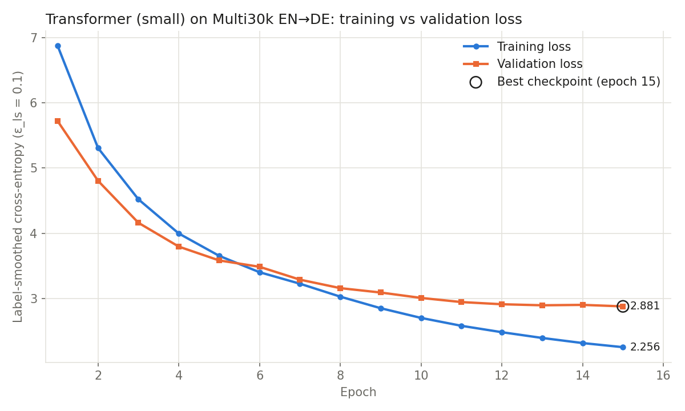

# Transformer from Scratch for English→German Neural Machine Translation

**Experiments 9 & 10 · Computational Linguistics and NLP Lab**

A faithful, from-scratch PyTorch implementation of the Transformer encoder–decoder from
**"Attention Is All You Need"** (Vaswani et al., NeurIPS 2017), trained and evaluated on the
**Multi30k** English–German corpus, with a Streamlit translation demo.

> No `nn.Transformer`, `nn.TransformerEncoder/Decoder`, `nn.MultiheadAttention` or pretrained
> models are used. Every component is written with basic tensor operations and `nn.Linear` /
> `nn.Embedding`. A unit test asserts this.

---

## 1. Project structure

```
transformer-mini-project/
├── config.py               # "small" and paper "base" configurations, paths, special tokens
├── prepare_data.py         # download + verify + clean Multi30k, train SentencePiece BPE
├── data_utils.py           # numerical encoding, padding, length-bucketed batching
├── train.py                # Adam + Noam warmup, label smoothing, clipping, best checkpoint
├── evaluate.py             # SacreBLEU (greedy + beam), losses, inference time, graphs
├── translate.py            # Translator class + command-line translation
├── app.py                  # Streamlit UI: translate (greedy/beam), metrics dashboard, architecture
├── app_detailed.py         # extended demo: test-set browser, per-epoch log, attention heatmaps
├── .streamlit/config.toml  # light theme for the UI
├── plotting.py             # loss-curve plot
├── capture_screenshots.py  # Playwright screenshots of the running app
├── models/
│   ├── attention.py        # scaled dot-product attention, multi-head attention
│   ├── positional_encoding.py
│   ├── layers.py           # embedding×√d, LayerNorm, FFN, residual+post-LN sublayer
│   ├── encoder.py          # EncoderLayer, Encoder stack
│   ├── decoder.py          # DecoderLayer (masked self-attn, cross-attn, FFN), Decoder stack
│   ├── transformer.py      # full model, masks, linear+softmax generator, weight tying
│   └── decoding.py         # greedy decoding and beam search (k=4, α=0.6)
├── tests/
│   ├── test_components.py  # 28 unit tests (shapes, masks, maths, checkpoint, decoding)
│   ├── test_app.py         # headless Streamlit test (loads model, clicks Translate)
│   └── overfit_test.py     # memorise 32 real sentence pairs
├── data/                   # raw/ (downloaded .gz) and processed/ (clean text, stats.json)
├── tokenizer/              # spm_bpe.model / spm_bpe.vocab
├── checkpoints/            # small_best.pt
├── results/
│   ├── graphs/             # loss curve, cross-attention heatmap
│   ├── predictions/        # all test-set translations (CSV) and samples (MD)
│   ├── metrics/            # training history, training log, evaluation metrics, overfit test
│   └── screenshots/        # UI screenshots (ui_*.png) and detailed-app screenshots
├── report.md               # academic mini-project report
└── viva_questions.md       # 30 viva questions with answers
```

## 2. Installation

```bash
cd transformer-mini-project
python -m venv .venv
# Windows: .venv\Scripts\activate      Linux/macOS: source .venv/bin/activate
pip install -r requirements.txt
```

Tested with Python 3.13, PyTorch 2.10 (CPU build), and Windows 11. A CUDA GPU is used automatically if
present; otherwise the code falls back to the CPU.

## 3. How to run (in order)

```bash
# 0) Unit tests for every component, plus the overfit sanity check
python -m unittest discover -s tests -v
python tests/overfit_test.py
python tests/test_app.py                  # after training: headless app test
python capture_screenshots.py             # after training: UI screenshots (needs Edge/Chrome)

# 1) Download Multi30k, verify splits, clean, train the joint 8k BPE tokenizer
python prepare_data.py

# 2) Train (prints the active configuration; saves checkpoints/small_best.pt)
python train.py --config small            # 15 epochs, ~75 min on a laptop CPU
python train.py --config base             # paper Transformer-base: needs a GPU
python train.py --config small --subset 2000 --epochs 2 --tag smoke   # 5-minute smoke test

# 3) Evaluate on the held-out test set (BLEU, losses, inference time, graphs, predictions)
python evaluate.py --checkpoint checkpoints/small_best.pt

# 4) Translate from the command line
python translate.py "A man is riding a bicycle down the street."
python translate.py            # interactive

# 5) Web demo
streamlit run app.py                     # or: python -m streamlit run app.py
python -m streamlit run app_detailed.py  # extended version
```

If PowerShell prints garbled umlauts, run `$env:PYTHONIOENCODING="utf-8"` first.

## 4. Configurations

| | N (enc/dec) | d_model | h | d_k=d_v | d_ff | dropout | ε_ls | warmup | params (8k vocab) |
|---|---|---|---|---|---|---|---|---|---|
| `small` (trained) | 3 / 3 | 256 | 8 | 32 | 1024 | 0.1 | 0.1 | 1500 | 7.58 M |
| `base` (paper, Table 3) | 6 / 6 | 512 | 8 | 64 | 2048 | 0.1 | 0.1 | 4000 | 48.2 M (≈63 M with a 37k vocab) |

Both use Adam (β₁ = 0.9, β₂ = 0.98, ε = 10⁻⁹), the Noam schedule (Eq. 3 of the paper), post-LayerNorm,
sinusoidal positions, a shared source/target embedding tied to the pre-softmax projection, gradient
clipping at 1.0, batch size 128 sentences, and seed 42. The architecture can never be overridden from
the command line; only `--epochs`, `--batch-size` and `--warmup` can.

**Resource note.** The development machine (AMD Ryzen 5 5500U, 16 GB RAM, no CUDA GPU) trains the small
model at about 1 s/step. The base model takes about 5 s/step (8+ hours for 25 epochs), so the base model is implemented
and unit-tested but was not trained here. `train.py` prints this recommendation automatically.

## 5. Results

See [`results/metrics/small_metrics.json`](results/metrics/small_metrics.json),
[`results/graphs/`](results/graphs/), and [`report.md`](report.md) §19–21.

Small configuration, best checkpoint at epoch 15 (15 epochs, 75 min on CPU),
Multi30k **test_2016_flickr** (1,000 sentences):

| Metric | Value |
|---|---|
| BLEU, beam search k=4 α=0.6 (SacreBLEU) | **37.09** |
| BLEU, greedy | 36.25 |
| chrF, beam | 60.98 |
| Training loss (label-smoothed, epoch 15) | 2.256 |
| Validation loss / perplexity | 2.881 / 6.17 |
| Test loss / perplexity | 2.858 / 6.00 |
| Trainable parameters | 7,577,600 |
| Inference (CPU) | 119 ms/sentence greedy, 208 ms/sentence beam |
| Overfit sanity test | 32/32 pairs memorised, loss 9.44 → 4.7e-05 |



> These are **Multi30k** results. The paper's WMT 2014 EN–DE scores (27.3 BLEU base, 28.4 big) were
> **not** reproduced here and are not comparable (different data size, domain and test set).

## 6. Deployment (GitHub + Render)

The repository includes the trained checkpoint (`checkpoints/small_best.pt`, 30 MB) and tokenizer, so the
Streamlit UI can be deployed without retraining. Everything runs on the server's CPU; no external
translation API is used.

[](https://render.com/deploy?repo=https://github.com/12SohamVerma/transformer-nmt-en-de)

**Render (free web service).** `render.yaml` is a Render Blueprint. Click the button above, or:

1. Sign in at <https://dashboard.render.com> with GitHub.
2. **New + → Blueprint** → select this repository → **Apply**.
3. Wait for the build (~3–5 min: CPU-only PyTorch + Streamlit), then open the service URL.

Build: `pip install torch==2.10.0 --index-url https://download.pytorch.org/whl/cpu && pip install -r requirements-render.txt`
Start: `streamlit run app.py --server.port $PORT --server.address 0.0.0.0 --server.headless true`

Notes: the app needs about 320 MB of RAM with the model loaded, which fits the 512 MB free instance.
Free services sleep after ~15 minutes without traffic, so the first request after a pause takes about a minute.

## 7. References

1. A. Vaswani et al., "Attention Is All You Need," *NeurIPS 30*, 2017. arXiv:1706.03762.
2. D. Elliott, S. Frank, K. Sima'an, L. Specia, "Multi30K: Multilingual English-German Image Descriptions," *Proc. 5th Workshop on Vision and Language*, ACL 2016.
3. T. Kudo, J. Richardson, "SentencePiece," *EMNLP 2018 (demo)*.
4. M. Post, "A Call for Clarity in Reporting BLEU Scores," *WMT 2018* (SacreBLEU).
