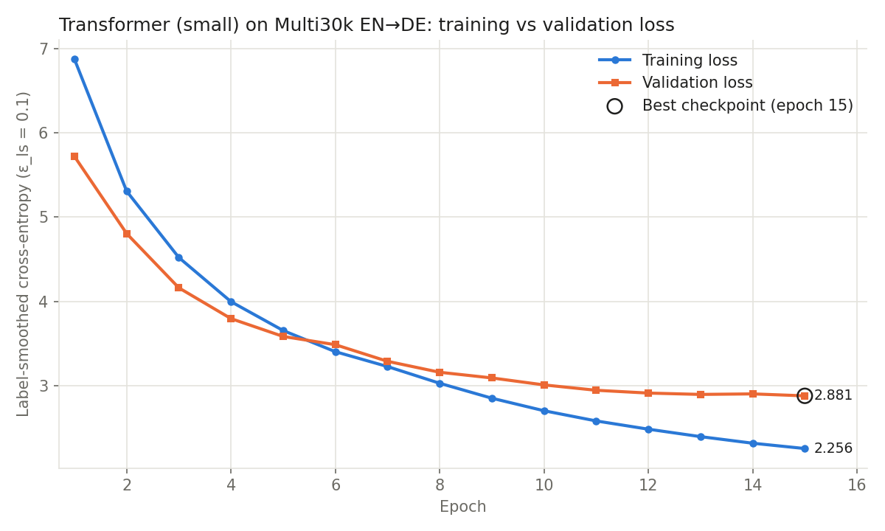
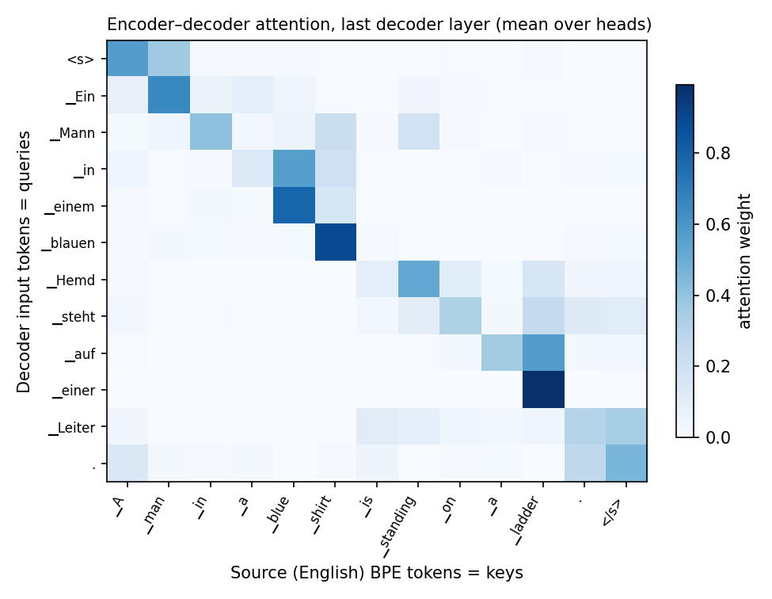

# Implementation of Transformer Architecture for Neural Machine Translation Using PyTorch

---

<div align="center">

### Mini-Project Report

**Computational Linguistics and Natural Language Processing Laboratory**
**Experiments 9 & 10**

**Based on the research paper**
*Attention Is All You Need* (Vaswani et al., NeurIPS 2017)

**Application:** English → German Neural Machine Translation
**Dataset:** Multi30k (Task 1) · **Framework:** PyTorch

| | |
|---|---|
| Student name | `__________________` |
| Roll number | `__________________` |
| Class / Division | `__________________` |
| Guide / Faculty | `__________________` |
| Institute | `__________________` |
| Academic year | 2026–27 |
| Date of submission | `__________________` |

</div>

---

## Table of Contents
1. Abstract
2. Introduction
3. Problem Statement
4. Objectives
5. Literature Review
6. Research Paper Overview
7. Transformer Architecture
8. Mathematical Formulation
9. Scaled Dot-Product Attention
10. Multi-Head Attention
11. Positional Encoding
12. Encoder and Decoder
13. Dataset Description
14. Proposed Methodology
15. System Architecture
16. Implementation Details
17. Experimental Setup
18. Results and Evaluation
19. Graphs and Visualizations
20. Sample Translation Results
21. Advantages
22. Limitations
23. Conclusion
24. References

---

## 1. Abstract

This project implements the Transformer encoder–decoder architecture of Vaswani et al. (2017) from scratch in PyTorch and applies it to English-to-German neural machine translation (NMT). Every component described in the paper is written manually from tensor operations and basic layers: token embeddings, sinusoidal positional encoding, scaled dot-product attention, multi-head self-attention, masked self-attention, encoder–decoder cross-attention, position-wise feed-forward networks, residual connections, layer normalisation, the encoder and decoder stacks, and the output linear-softmax projection. PyTorch's built-in `nn.Transformer` modules are not used. The model is trained on the Multi30k corpus (29,000 sentence pairs) with a joint SentencePiece BPE vocabulary, using the paper's training method: Adam with the inverse-square-root warmup schedule, label smoothing (ε = 0.1), residual dropout, and teacher forcing with padding and causal masks. Because only a laptop CPU was available, a reduced configuration (3+3 layers, d_model = 256, 7.6 M parameters) was trained. The paper's Transformer-base configuration is also implemented and verified. On the held-out Multi30k test_2016_flickr set the trained model reaches **37.09 BLEU** with beam search (SacreBLEU) and **36.25 BLEU** with greedy decoding. These Multi30k results are not comparable to the paper's WMT 2014 results. A Streamlit application demonstrates live translation and visualises the model's attention.

**Keywords:** Transformer, self-attention, multi-head attention, neural machine translation, positional encoding, BLEU, Multi30k, PyTorch.

---

## 2. Introduction

Machine translation is one of the oldest problems in computational linguistics. Rule-based systems gave way to statistical phrase-based MT, and then (from 2014) to **neural machine translation**, where a single neural network maps a source sentence to a target sentence. Early NMT systems were *sequence-to-sequence* models built from recurrent neural networks (RNNs / LSTMs / GRUs): an encoder RNN compresses the source sentence, and a decoder RNN generates the translation word by word. Adding an *attention* mechanism (Bahdanau et al., 2015) let the decoder look back at all encoder states and greatly improved translation of long sentences.

Recurrent models still have a basic weakness: they process tokens **sequentially**. The hidden state at time t depends on the state at time t−1, so computation cannot be parallelised along the sentence, and information between distant words must travel through many steps. In 2017, Vaswani et al. proposed the **Transformer**, a model that "dispenses with recurrence and convolutions entirely" and relies **only on attention**. It trained faster and set new state-of-the-art BLEU scores on WMT 2014 English–German and English–French. The Transformer became the foundation of modern NLP (BERT, GPT, T5, and today's large language models).

This mini-project rebuilds the original Transformer in PyTorch, component by component, to understand and demonstrate each mechanism, and evaluates it on a real translation task.

---

## 3. Problem Statement

Design, implement, train, and evaluate the Transformer encoder–decoder architecture described in *Attention Is All You Need* **from scratch** in PyTorch, without using pre-built Transformer modules or pretrained models. Apply it to English→German translation on the Multi30k parallel corpus. Measure translation quality with BLEU and loss metrics on a held-out test set, and provide an interactive interface that demonstrates the trained model.

---

## 4. Objectives

1. Study the Transformer architecture and its mathematical formulation from the original paper.
2. Implement every component manually in PyTorch: embedding, positional encoding, scaled dot-product attention, multi-head self-, masked-, and cross-attention, the feed-forward network, residual connections with layer normalisation, the encoder and decoder stacks, and the linear + softmax output.
3. Build a reproducible data pipeline for Multi30k: download, verification, cleaning, sub-word (BPE) tokenisation, vocabulary, padding, and batching.
4. Train the model with the paper's method: Adam, Noam warmup schedule, label smoothing, dropout, teacher forcing, and masks.
5. Verify correctness with unit tests and an overfitting sanity check.
6. Evaluate with SacreBLEU, training/validation/test loss, inference time, and parameter count.
7. Build a Streamlit web application for live translation and visualisation.
8. Report results honestly, separating this Multi30k experiment from the paper's WMT 2014 experiments.

---

## 5. Literature Review

| Year | Work | Contribution | Limitation addressed later |
|---|---|---|---|
| 1997 | Hochreiter & Schmidhuber – **LSTM** | Gated memory cell reduces vanishing gradients in RNNs | Still sequential, slow on long sequences |
| 2014 | Sutskever, Vinyals & Le – **Seq2Seq** | End-to-end encoder–decoder LSTM for MT | Whole sentence squeezed into one fixed-size vector |
| 2014 | Cho et al. – **GRU / RNN Encoder–Decoder** | Simpler gated unit; phrase representations | Same fixed-vector bottleneck |
| 2015 | Bahdanau, Cho & Bengio – **Additive attention** | Decoder attends to all encoder states (soft alignment) | Still recurrent, so no parallelism |
| 2015 | Luong, Pham & Manning – **Multiplicative attention** | Dot-product scoring, global/local attention | Still recurrent |
| 2016 | Sennrich, Haddow & Birch – **BPE sub-words** | Open-vocabulary NMT via byte-pair encoding | — |
| 2016 | Wu et al. – **GNMT** | Deep LSTM NMT in production; length penalty for beam search | Very expensive to train |
| 2016 | Ba, Kiros & Hinton – **Layer Normalisation** | Batch-independent normalisation for sequence models | — |
| 2016 | He et al. – **Residual learning** | Skip connections enable very deep networks | — |
| 2017 | Gehring et al. – **ConvS2S** | Convolutional seq2seq, parallel over positions | Path length between distant words grows with log/linear depth |
| 2017 | **Vaswani et al. – Transformer** | Attention-only encoder–decoder; O(1) path length; fully parallel | O(n²) attention cost (addressed by later efficient Transformers) |

The Transformer combines ideas from this line of work: attention from Bahdanau/Luong, residual connections from He et al., layer normalisation from Ba et al., and sub-word units from Sennrich et al. Its key new step is using **self-attention** as the *only* mechanism for building sequence representations.

---

## 6. Research Paper Overview

**Citation:** A. Vaswani, N. Shazeer, N. Parmar, J. Uszkoreit, L. Jones, A. N. Gomez, Ł. Kaiser, I. Polosukhin. *Attention Is All You Need.* Advances in Neural Information Processing Systems 30 (NeurIPS 2017), pp. 5998–6008. arXiv:1706.03762.

**Main contributions**
1. The **Transformer**, the first sequence transduction model based entirely on attention.
2. **Scaled dot-product attention** and **multi-head attention**.
3. **Sinusoidal positional encodings** that inject word order without recurrence.
4. A training method: Adam with warmup + inverse-square-root decay, residual dropout, and label smoothing.

**Paper experiments (for context only; not reproduced in this project)**

| Setting | Paper |
|---|---|
| Data | WMT 2014 EN–DE (~4.5 M pairs), WMT 2014 EN–FR (36 M pairs) |
| Vocabulary | ~37,000 shared BPE tokens (EN–DE) |
| Hardware | 8 × NVIDIA P100 GPUs |
| Training | base: 100k steps (~12 h); big: 300k steps (3.5 days) |
| Batch | ~25,000 source + 25,000 target tokens |
| Decoding | beam size 4, length penalty α = 0.6, checkpoint averaging |
| Result EN–DE (newstest2014) | **27.3 BLEU (base)**, **28.4 BLEU (big)** |
| Result EN–FR | 38.1 (base), 41.8 (big) BLEU |

The paper also shows that the Transformer generalises to English constituency parsing.

---

## 7. Transformer Architecture

The Transformer is an **encoder–decoder** model (Figure 1 of the paper):

```
            English sentence                        German prefix (shifted right)
                   │                                          │
      Input Embedding × √d_model                  Output Embedding × √d_model
                   + Positional Encoding                      + Positional Encoding
                   │                                          │
   ┌───────────────▼──────────────┐          ┌────────────────▼──────────────────┐
   │  ENCODER LAYER  (× N)        │          │  DECODER LAYER  (× N)             │
   │  ┌────────────────────────┐  │          │  ┌─────────────────────────────┐  │
   │  │ Multi-Head Self-Attn   │  │          │  │ Masked Multi-Head Self-Attn │  │
   │  └──────────┬─────────────┘  │          │  └──────────┬──────────────────┘  │
   │       Add & LayerNorm        │          │       Add & LayerNorm             │
   │  ┌──────────▼─────────────┐  │  memory  │  ┌──────────▼──────────────────┐  │
   │  │ Position-wise FFN      │  │─────────►│  │ Encoder–Decoder Attention   │  │
   │  └──────────┬─────────────┘  │  (K, V)  │  └──────────┬──────────────────┘  │
   │       Add & LayerNorm        │          │       Add & LayerNorm             │
   └──────────────────────────────┘          │  ┌──────────▼──────────────────┐  │
                                             │  │ Position-wise FFN           │  │
                                             │  └──────────┬──────────────────┘  │
                                             │       Add & LayerNorm             │
                                             └─────────────┬─────────────────────┘
                                                     Linear (tied weights)
                                                           │
                                                        Softmax
                                                           │
                                          P(y_t | y_<t, x)  over German vocabulary
```

| # | Component | Role | File |
|---|---|---|---|
| 1 | Input embedding | token id → d_model vector, scaled by √d_model | `models/layers.py` |
| 2 | Positional encoding | adds sinusoidal position signal | `models/positional_encoding.py` |
| 3 | Scaled dot-product attention | softmax(QKᵀ/√d_k)V | `models/attention.py` |
| 4 | Multi-head self-attention | h parallel attentions over the same sequence | `models/attention.py` |
| 5 | Masked self-attention | decoder self-attention with causal mask | `models/decoder.py` |
| 6 | Cross-attention | decoder queries, encoder keys/values | `models/decoder.py` |
| 7 | Feed-forward network | two linear layers with ReLU, per position | `models/layers.py` |
| 8 | Residual connection | x + Sublayer(x) | `models/layers.py` |
| 9 | Layer normalisation | per-token feature normalisation | `models/layers.py` |
| 10 | Encoder layer | self-attn + FFN | `models/encoder.py` |
| 11 | Decoder layer | masked self-attn + cross-attn + FFN | `models/decoder.py` |
| 12–13 | Encoder / decoder stack | N layers each | `models/encoder.py`, `models/decoder.py` |
| 14 | Linear projection | d_model → vocabulary logits | `models/transformer.py` (`Generator`) |
| 15 | Softmax | logits → token probabilities | `models/transformer.py` (`Generator`) |

---

## 8. Mathematical Formulation

Let the source sentence be x = (x₁,…,x_n) and the target y = (y₁,…,y_m). NMT models the conditional probability auto-regressively:

$$P(y \mid x) = \prod_{t=1}^{m} P(y_t \mid y_{<t}, x)$$

**Embedding.** With embedding matrix E ∈ ℝ^{V×d_model}: e_i = √d_model · E[x_i].

**Input to the first layer.** h⁽⁰⁾_i = Dropout(e_i + PE(i)).

**Sub-layer with residual connection and post-layer-normalisation** (paper §3.1):

$$\text{out} = \mathrm{LayerNorm}\big(x + \mathrm{Dropout}(\mathrm{Sublayer}(x))\big)$$

$$\mathrm{LayerNorm}(x) = \gamma \odot \frac{x - \mu}{\sqrt{\sigma^2 + \epsilon}} + \beta,\quad \mu = \tfrac{1}{d}\sum_j x_j,\ \sigma^2 = \tfrac{1}{d}\sum_j (x_j-\mu)^2$$

**Feed-forward network** (Eq. 2): $\mathrm{FFN}(x) = \max(0, xW_1 + b_1)W_2 + b_2$, W₁ ∈ ℝ^{d_model×d_ff}, W₂ ∈ ℝ^{d_ff×d_model}.

**Output distribution:** $P(y_t \mid y_{<t}, x) = \mathrm{softmax}(h^{(N)}_t E^\top)$ (output weights tied to the embedding, §3.4).

**Training objective – label-smoothed cross-entropy.** For gold token y_t and smoothing ε = 0.1 over V classes, the target distribution is q(k) = (1−ε)·𝟙[k = y_t] + ε/V, and

$$\mathcal{L} = -\frac{1}{|T|}\sum_{t \in T}\sum_{k=1}^{V} q(k)\log P(k \mid y_{<t}, x)$$

where T is the set of non-padding target positions.

**Learning-rate schedule** (Eq. 3):

$$lrate = d_{model}^{-0.5}\cdot\min\!\big(step^{-0.5},\ step\cdot warmup\_steps^{-1.5}\big)$$

**Relation to the code:**

| Equation | Code |
|---|---|
| √d_model · E[x] | `TokenEmbedding.forward`: `self.embedding(tokens) * self.scale` |
| LayerNorm(x + Dropout(Sublayer(x))) | `SublayerConnection.forward`: `self.norm(x + self.dropout(sublayer(x)))` |
| LayerNorm formula | `LayerNorm.forward`: `gamma * (x - mean) / sqrt(var + eps) + beta` |
| FFN | `PositionwiseFeedForward.forward`: `linear2(relu(linear1(x)))` |
| softmax(hEᵀ) | `Generator` with `proj.weight` tied to the embedding weight |
| Label-smoothed CE | `nn.CrossEntropyLoss(ignore_index=PAD, label_smoothing=0.1)` in `train.py` |
| Eq. 3 | `noam_lr()` in `train.py`, applied through `LambdaLR` |

---

## 9. Scaled Dot-Product Attention

$$\mathrm{Attention}(Q,K,V) = \mathrm{softmax}\!\left(\frac{QK^\top}{\sqrt{d_k}} + M\right)V$$

- **Q** ∈ ℝ^{n_q×d_k}: queries ("what am I looking for?")
- **K** ∈ ℝ^{n_k×d_k}: keys ("what do I contain?")
- **V** ∈ ℝ^{n_k×d_v}: values ("what do I return?")
- **M**: mask, 0 for allowed positions and −∞ (in practice the most negative float) for blocked ones.

**Why scale by √d_k?** If the components of q and k are independent with mean 0 and variance 1, then q·k = Σᵢ qᵢkᵢ has variance d_k. Large-magnitude scores saturate the softmax (one weight ≈ 1, the rest ≈ 0), and its gradients vanish. Dividing by √d_k restores unit variance.

**Implementation** (`models/attention.py`):

```python
scores = torch.matmul(query, key.transpose(-2, -1)) / math.sqrt(d_k)       # QK^T / sqrt(d_k)
if mask is not None:
    scores = scores.masked_fill(~mask, torch.finfo(scores.dtype).min)        # + M
weights = torch.softmax(scores, dim=-1)                                     # rows sum to 1
return torch.matmul(weights, value), weights                                # weights · V
```

**Masks.**
* **Padding mask** (B,1,1,S): `src != PAD`, so padded keys receive zero weight.
* **Causal (look-ahead) mask** (1,1,T,T): lower-triangular `torch.tril(ones)`, so position i sees only j ≤ i.
* The decoder self-attention uses `padding_mask & causal_mask`.

---

## 10. Multi-Head Attention

$$\mathrm{MultiHead}(Q,K,V) = \mathrm{Concat}(\mathrm{head}_1,\dots,\mathrm{head}_h)\,W^O,\qquad \mathrm{head}_i = \mathrm{Attention}(QW_i^Q, KW_i^K, VW_i^V)$$

with W_i^Q, W_i^K ∈ ℝ^{d_model×d_k}, W_i^V ∈ ℝ^{d_model×d_v}, W^O ∈ ℝ^{hd_v×d_model}, and d_k = d_v = d_model/h. In the base model h = 8 and d_k = 64.

Each head attends within its own learned subspace, so different heads can capture different relations (for example word alignment, local context, or agreement). Because each head has dimension d_model/h, the total cost is similar to single-head attention at full dimension.

**Implementation.** All h projections W_i^Q are stored as one `nn.Linear(d_model, d_model)`. The output is reshaped `(B, L, d_model) → (B, h, L, d_k)` and attention is computed for all heads in one batched matmul. The reverse reshape implements the concatenation, and `w_o` implements W^O. The unit test `test_multi_head_equals_per_head_computation` checks that this matches an explicit loop over heads followed by concatenation.

**Three uses in the model:**

| Use | Q | K, V | Mask |
|---|---|---|---|
| Encoder self-attention | encoder states | encoder states | source padding |
| Decoder masked self-attention | decoder states | decoder states | target padding ∧ causal |
| Encoder–decoder cross-attention | decoder states | encoder output (memory) | source padding |

---

## 11. Positional Encoding

Self-attention is **permutation-invariant**: shuffling the input words shuffles the outputs the same way, so word order would be lost. The paper adds a fixed sinusoidal signal to the embeddings:

$$PE_{(pos,2i)} = \sin\!\left(\frac{pos}{10000^{2i/d_{model}}}\right),\qquad PE_{(pos,2i+1)} = \cos\!\left(\frac{pos}{10000^{2i/d_{model}}}\right)$$

* Each dimension pair (2i, 2i+1) is a sinusoid with wavelength 2π·10000^{2i/d_model}, which forms a geometric progression from 2π to 20000π.
* For any offset k, PE_{pos+k} is a **linear function** (a rotation within each sin/cos pair) of PE_{pos}, so the model can easily learn to attend by relative position.
* There are no parameters to learn. The paper found learned positional embeddings performed nearly identically (Table 3, row E).

**Implementation** (`models/positional_encoding.py`): `div_term = exp(arange(0, d, 2) · (−ln 10000 / d))` computes 1/10000^{2i/d} in log-space. Then `pe[:, 0::2] = sin(pos·div_term)` and `pe[:, 1::2] = cos(pos·div_term)`. The table is registered as a non-trainable buffer and added to the embeddings, followed by dropout. A unit test compares individual entries against the formula.

---

## 12. Encoder and Decoder

**Encoder layer** (`EncoderLayer`):
```
x = LayerNorm(x + Dropout(SelfAttention(x, x, x, src_mask)))
x = LayerNorm(x + Dropout(FFN(x)))
```

**Decoder layer** (`DecoderLayer`):
```
y = LayerNorm(y + Dropout(MaskedSelfAttention(y, y, y, tgt_mask)))
y = LayerNorm(y + Dropout(CrossAttention(y, memory, memory, src_mask)))
y = LayerNorm(y + Dropout(FFN(y)))
```

**Stacks.** `Encoder` = embedding → positional encoding → N encoder layers, and `Decoder` = embedding → positional encoding → N decoder layers. Because the paper uses post-LN, there is no extra final LayerNorm.

**Teacher forcing.** During training the decoder receives `<s> y₁ … y_{m−1}` and is trained to predict `y₁ … y_m </s>` at all positions in parallel. The causal mask ensures that the prediction at position t uses only y_{<t}.

**Inference.** The decoder runs auto-regressively. *Greedy* decoding picks argmax P(y_t | ·) at each step. *Beam search* keeps the k = 4 best partial hypotheses, and finished hypotheses are ranked by log P / lp(Y) with the GNMT length penalty lp(Y) = ((5+|Y|)/6)^α, α = 0.6. The maximum output length is input length + 50, as in the paper.

**Weight tying** (§3.4). Source and target share one joint BPE vocabulary, so the source embedding, target embedding, and pre-softmax projection all share one matrix. This reduces parameters by 2 × V × d_model.

---

## 13. Dataset Description

**Multi30k** (Elliott et al., 2016) extends the Flickr30k image-captioning dataset with professional German translations of English image descriptions. We use Task 1 (translation), downloaded from the official repository `github.com/multi30k/dataset` (`data/task1/raw`).

| Split | File | Sentence pairs | Avg. words EN / DE | Max words EN / DE | Avg. BPE tokens EN / DE |
|---|---|---|---|---|---|
| Train | train.{en,de} | 29,000 | 11.90 / 11.12 | 37 / 39 | 14.28 / 14.77 |
| Validation | val.{en,de} | 1,014 | 12.00 / 11.41 | 27 / 30 | 14.46 / 15.31 |
| Test | test_2016_flickr.{en,de} | 1,000 | 11.88 / 10.90 | 32 / 30 | 14.18 / 14.30 |

(Values computed by `prepare_data.py` and stored in `data/processed/stats.json`.)

Example pair: *"Two young, White males are outside near many bushes."* → *"Zwei junge weiße Männer sind im Freien in der Nähe vieler Büsche."*

Verification performed: split names, EN/DE line-count alignment, expected sizes, empty lines (0), and the number of test sentences that also appear in the training set (0).

**How it differs from the paper's data.** WMT14 EN–DE has ~4.5 M sentence pairs of news and parliamentary text. Multi30k has 29 k short, simple image descriptions, about 155 times less data from a narrow domain. BLEU scores on the two are therefore not comparable.

---

## 14. Proposed Methodology

1. **Data acquisition and verification** – download the official gzip files, check the schema and splits, and fall back to a Hugging Face mirror if GitHub is unavailable.
2. **Text cleaning** – Unicode NFC normalisation, removal of control characters, whitespace normalisation. Case and punctuation are kept because BLEU is case-sensitive.
3. **Sub-word tokenisation** – a joint EN+DE SentencePiece BPE model (8,000 units) trained on the training split only. The special tokens are `<pad>`=0, `<unk>`=1, `<s>`=2, `</s>`=3.
4. **Numerical encoding** – source: `BPE(en) + </s>`; target: `<s> + BPE(de) + </s>`.
5. **Batching** – length-bucketed batches of 128 sentence pairs, padded with `<pad>` to the longest sequence in the batch, with batch order shuffled every epoch.
6. **Model** – the from-scratch Transformer (§7–12).
7. **Training** – teacher forcing, label-smoothed CE, Adam + Noam schedule, gradient clipping, dropout; the best checkpoint is selected by validation loss.
8. **Evaluation** – test-set loss, perplexity, SacreBLEU (greedy and beam), chrF, inference time, and parameter count.
9. **Deployment** – Streamlit app that loads the local checkpoint.

---

## 15. System Architecture

```
┌──────────────┐   ┌────────────────┐   ┌──────────────┐   ┌───────────────┐   ┌──────────────┐
│prepare_data.py│──►│ data/processed │──►│  train.py    │──►│ checkpoints/  │──►│ evaluate.py  │
│ download,     │   │ tokenizer/     │   │ Noam, LS,    │   │ small_best.pt │   │ BLEU, losses │
│ verify, clean,│   │ spm_bpe.model  │   │ clipping,    │   └───────┬───────┘   │ graphs, CSV  │
│ BPE training  │   └───────┬────────┘   │ best ckpt    │           │           └──────┬───────┘
└──────────────┘           │            └──────┬───────┘           │                  │
                           │                   │ uses              ▼                  ▼
                           │            ┌──────▼────────┐   ┌──────────────┐   ┌──────────────┐
                           └───────────►│ models/ (from │◄──│ translate.py │◄──│   app.py     │
                                        │ scratch)      │   │ Translator   │   │  Streamlit   │
                                        └───────────────┘   └──────────────┘   └──────────────┘
```

---

## 16. Implementation Details

| Item | Choice | Paper reference |
|---|---|---|
| Framework | PyTorch 2.10, Python 3.13 | — |
| Forbidden modules | `nn.Transformer*`, `nn.MultiheadAttention` not used (asserted by a unit test) | — |
| Normalisation | post-LN, own `LayerNorm` class, ε = 1e-6 | §3.1 |
| Attention masking | boolean masks, blocked scores set to `finfo.min` | §3.2.3 |
| Embedding scaling | × √d_model | §3.4 |
| Weight tying | shared src/tgt embedding = pre-softmax weight | §3.4 |
| Dropout | P_drop = 0.1 on every sub-layer output and on embedding + PE sums | §5.4 |
| Label smoothing | ε_ls = 0.1 (`CrossEntropyLoss(label_smoothing=0.1)`) | §5.4 |
| Optimiser | Adam β₁ = 0.9, β₂ = 0.98, ε = 1e-9 | §5.3 |
| LR schedule | Noam (Eq. 3) via `LambdaLR` | §5.3 |
| Gradient clipping | global norm 1.0 | (not in paper; added for stability) |
| Initialisation | Xavier-uniform for weight matrices, N(0, d_model^-0.5) for the shared embedding | (not specified in paper) |
| Decoding | greedy, and beam k = 4, α = 0.6, max length = input + 50; `</s>` forbidden as the first token (min. length 1) | §6.1 |
| Reproducibility | seed 42 for `random`, `numpy`, `torch`; deterministic batch shuffling per epoch | — |

**Verification (Phase 2 and 8).** `tests/test_components.py` contains 28 unit tests, all passing:
positional-encoding shape and formula; attention output shape, rows summing to 1, agreement with the manual formula; multi-head shapes and equivalence to per-head computation; padding mask (padded keys get exactly 0 weight, and appending padding does not change the logits); causal mask (lower-triangular, and changing a future token does not change past outputs); LayerNorm equal to `nn.LayerNorm`; encoder/decoder forward shapes; output vocabulary dimension and softmax normalisation; weight tying; base configuration equal to the paper (N = 6, d_model = 512, h = 8, d_k = d_v = 64, d_ff = 2048, ~63 M parameters with a 37k vocabulary vs. 65 M in the paper); absence of built-in Transformer modules; finite loss and gradients with initial loss ≈ ln V; padding ignored by the loss; checkpoint save/load round-trip; greedy and beam decoding; beam size 1 equal to greedy; decoders never return an empty translation.

**Overfit test** (`tests/overfit_test.py`): a 2+2-layer model trained on 32 real Multi30k pairs. The loss fell from 9.44 to 4.7 × 10⁻⁵ in 500 steps and the model reproduced **32/32** training translations exactly, which confirms that the network, masks, and training loop can learn.

---

## 17. Experimental Setup

| | Value |
|---|---|
| Hardware | AMD Ryzen 5 5500U (6 cores / 12 threads), 16 GB RAM, **no CUDA GPU** (CPU training) |
| OS | Windows 11 |
| Trained configuration | **small**: N = 3 + 3, d_model = 256, h = 8, d_k = d_v = 32, d_ff = 1024, P_drop = 0.1, ε_ls = 0.1 |
| Parameters | 7,577,600 (trainable, tied weights counted once) |
| Vocabulary | 8,000 joint SentencePiece BPE |
| Batch size | 128 sentence pairs (≈ 1,900 target tokens) |
| Warmup steps | 1,500 (peak lr = 256^-0.5 · 1500^-0.5 ≈ 1.6 × 10⁻³) |
| Epochs | **15** (227 steps/epoch → 3,405 steps); originally planned 25, stopped after epoch 15 by decision to fit the lab time budget |
| Model selection | lowest validation loss |
| Test-time decoding | beam search k = 4, α = 0.6 (and greedy) |
| Base configuration | implemented and unit-tested (48.2 M params with 8k vocab); ~5 s/step on this CPU, so not trained |

**Why not train the base configuration?** A measured benchmark gave about 1 s per batch for *small* and about 5 s per batch for *base* on this CPU. Base would need 8+ hours for 25 epochs, and it is also over-parameterised for 29 k sentence pairs. As the project requirements specify, the base configuration was **not changed**; a smaller configuration was trained instead and is clearly labelled as such.

---

## 18. Results and Evaluation

All numbers below were produced by `train.py` and `evaluate.py` and are stored in `results/metrics/small_history.json` and `results/metrics/small_metrics.json`.

### 18.1 Final metrics (best checkpoint = epoch 15 of 15)

| Metric | Value |
|---|---|
| **BLEU – beam search (k = 4, α = 0.6)** | **37.09** |
| BLEU – greedy decoding | 36.25 |
| chrF – beam search | 60.98 |
| BLEU details (beam) | `BLEU = 37.09 69.2/45.0/31.7/22.3 (BP = 0.963 ratio = 0.963 hyp_len = 11664 ref_len = 12106)` |
| SacreBLEU signature | `nrefs:1|case:mixed|eff:no|tok:13a|smooth:exp|version:2.6.0` |
| Training loss (epoch 15, label-smoothed) | 2.2561 |
| Validation loss (label-smoothed) | 2.8811 |
| Validation perplexity (un-smoothed) | 6.17 |
| **Test loss (label-smoothed)** | **2.8575** |
| Test perplexity (un-smoothed) | 6.00 |
| Trainable parameters | 7,577,600 |
| Total training time (CPU) | 74.7 min (15 epochs × 227 steps) |
| Greedy decoding, whole test set (batched, CPU) | 104.8 s (105 ms / sentence) |
| Beam search, whole test set (one sentence at a time, CPU) | 207.6 s (208 ms / sentence) |
| Single-sentence greedy latency (mean of 50) | 119 ms |
| Exact matches with the reference | 69 / 1000 |
| Empty outputs | 0 |

*Loss* = label-smoothed cross-entropy per target BPE token (the training objective). *Perplexity* = exp(un-smoothed cross-entropy). BLEU is computed by SacreBLEU on detokenised model output against the original references (case-sensitive, `13a` tokenisation), so it is reproducible and not inflated by sub-word tokenisation.

### 18.2 Training progress (from `results/metrics/small_history.json`)

| Epoch | Train loss | Val loss | Val PPL | Learning rate (end of epoch) | Time (min) |
|---|---|---|---|---|---|
| 1 | 6.8721 | 5.7195 | 178.80 | 2.45e-04 | 5.2 |
| 2 | 5.3078 | 4.8053 | 61.82 | 4.90e-04 | 5.8 |
| 3 | 4.5213 | 4.1619 | 28.96 | 7.34e-04 | 4.6 |
| 4 | 3.9978 | 3.7968 | 18.55 | 9.78e-04 | 4.7 |
| 5 | 3.6553 | 3.5852 | 14.34 | 1.22e-03 | 4.9 |
| 6 | 3.4046 | 3.4876 | 12.64 | 1.47e-03 | 5.0 |
| 7 | 3.2284 | 3.2905 | 10.09 | 1.57e-03 | 4.9 |
| 8 | 3.0301 | 3.1606 | 8.60 | 1.47e-03 | 4.6 |
| 9 | 2.8530 | 3.0934 | 7.98 | 1.38e-03 | 5.2 |
| 10 | 2.7044 | 3.0106 | 7.21 | 1.31e-03 | 4.9 |
| 11 | 2.5835 | 2.9471 | 6.70 | 1.25e-03 | 4.8 |
| 12 | 2.4855 | 2.9139 | 6.45 | 1.20e-03 | 5.0 |
| 13 | 2.3973 | 2.8979 | 6.26 | 1.15e-03 | 5.0 |
| 14 | 2.3193 | 2.9042 | 6.36 | 1.11e-03 | 5.0 |
| 15 | 2.2561 | 2.8811 | 6.17 | 1.07e-03 | 5.1 |

Training was planned for 25 epochs and **stopped after epoch 15** to fit the lab time budget. The best checkpoint (lowest validation loss) is the last one, epoch 15. No NaN or infinite losses occurred.

### 18.3 BLEU by source-sentence length (test set, beam search)

| Source length (words) | Sentences | BLEU |
|---|---|---|
| ≤ 10 | 412 | 41.14 |
| 11–15 | 443 | 37.96 |
| 16–20 | 108 | 34.77 |
| > 20 | 37 | 19.57 |

Quality drops sharply for long sentences (> 20 words). These are rare in the training data, and errors accumulate during auto-regressive decoding.

### 18.4 Discussion

* **Learning works.** Validation perplexity fell from 178.8 after epoch 1 to 6.17, and the test loss (2.858) is very close to the validation loss (2.881), so the model generalises to unseen data.
* **Beam search helps.** Beam search (k = 4, α = 0.6, the paper's settings) gives +0.84 BLEU over greedy decoding.
* **Over-fitting begins.** After about epoch 12 the training loss keeps falling while the validation loss flattens (2.91 → 2.88), so the train–validation gap widens. This is expected for a 7.6 M-parameter model on 29 k sentence pairs.
* **Decoding bug found and fixed during evaluation.** The first evaluation produced 3 empty beam-search outputs: on hard inputs, emitting `</s>` immediately had the best length-normalised score. Forbidding `</s>` as the first token (minimum length 1, as in fairseq) removed this. A regression test was added, and beam BLEU went from 36.99 to 37.09.
* **Typical errors** (see §20): rare words copied or split wrongly (e.g. "Boston" → "Bo"), content omitted in long sentences, and hallucinated phrases for rare words (e.g. "home plate"). Frequent caption patterns ("Ein Mann in einem …", colours, clothing, actions) are translated reliably.
* **Comparison with the paper.** The paper reports 27.3 BLEU (base) on WMT14 newstest2014. Our 37.09 on Multi30k is **not** a better result: Multi30k sentences are short, simple, and repetitive, so BLEU is much higher on it. The two numbers measure different tasks and must not be compared directly. Published from-scratch Transformer baselines on Multi30k test2016 are typically in the mid-30s to around 40 BLEU, depending on model size and preprocessing. Our result is in that range, which is consistent with a correct implementation.

---

## 19. Graphs and Visualizations

**Figure 1 – Training vs validation loss** (`results/graphs/small_loss_curve.png`)



Both curves fall steeply during the warmup phase (epochs 1–7, learning rate rising to its peak of 1.57e-03 at step 1,500) and then more slowly as the learning rate decays as 1/√step. In early epochs the training loss is *higher* than the validation loss for two reasons: the reported training loss is averaged over an epoch during which the model is still improving, and dropout is active only during training. From epoch 6 the training loss is lower, and after about epoch 12 the validation loss plateaus at about 2.88 while the training loss keeps falling. This is the start of over-fitting, and the best-checkpoint logic protects against it.

**Figure 2 – Encoder–decoder attention** (`results/graphs/small_cross_attention.png`), last decoder layer averaged over the 8 heads, for the input *"A man in a blue shirt is standing on a ladder."*



Each row is a decoder input token (query) at the step where the model predicts the *next* German word, and each column is an English source token (key). For example, the row "einem" (predicting *blauen*) attends to "blue", and "einer" (predicting *Leiter*) attends to "ladder". The roughly diagonal pattern is a soft word alignment that the model learned without any alignment supervision.

**Figure 3 – Streamlit application** (`results/screenshots/`)

| Full page (beam search) | Greedy search |
|---|---|
|  |  |

The main interface (`app.py`) is a single page with four sections: project overview, translation (greedy or beam search with k = 4, α = 0.6), a model-performance dashboard read directly from `results/metrics/`, and an architecture overview. It loads `checkpoints/small_best.pt` once (Streamlit resource cache) and calls the project's own tokenizer and decoders. Example outputs captured from the running app: *"A little girl in a pink dress is climbing a tree."* → *"Ein kleines Mädchen in einem rosafarbenen Kleid klettert einen Baum hinauf."* (beam search), and *"Two dogs are playing in the snow."* → *"Zwei Hunde spielen im Schnee."* (greedy). The layout is responsive (`results/screenshots/ui_03_mobile.png`). A more detailed version with a test-set browser, per-epoch log and live cross-attention heatmaps is kept as `app_detailed.py` (screenshots `01_translate.png` to `04_paper_dataset.png`). Screenshots were captured automatically with `python capture_screenshots.py` (Playwright + Microsoft Edge).

---

## 20. Sample Translation Results

The table shows the first sentences of the Multi30k **test set** (not cherry-picked), translated with beam search. All 1,000 test translations are in `results/predictions/small_test_predictions.csv`.

| # | English input | Ground truth (German) | Model output (German) | Sentence BLEU |
|---|---|---|---|---|
| 1 | A man in an orange hat starring at something. | Ein Mann mit einem orangefarbenen Hut, der etwas anstarrt. | Ein Mann mit einem orangefarbenen Hut starrt auf etwas. | 50.3 |
| 2 | A Boston Terrier is running on lush green grass in front of a white fence. | Ein Boston Terrier läuft über saftig-grünes Gras vor einem weißen Zaun. | Ein Bo Terrier rennt auf grünem Gras vor einem weißen Zaun. | 44.8 |
| 3 | A girl in karate uniform breaking a stick with a front kick. | Ein Mädchen in einem Karateanzug bricht ein Brett mit einem Tritt. | Ein Mädchen in Karateanzug macht einen Stock mit einem Fußtritt vortritt. | 17.2 |
| 4 | Five people wearing winter jackets and helmets stand in the snow, with snowmobiles in the background. | Fünf Leute in Winterjacken und mit Helmen stehen im Schnee mit Schneemobilen im Hintergrund. | Fünf Personen mit Winterjacken und Helmen stehen im Schnee mit Schnee im Hintergrund. | 38.1 |
| 5 | People are fixing the roof of a house. | Leute Reparieren das Dach eines Hauses. | Leute reparieren das Dach eines Hauses. | 64.3 |
| 6 | A man in light colored clothing photographs a group of men wearing dark suits and hats standing around a woman dressed in a strapless gown. | Ein hell gekleideter Mann fotografiert eine Gruppe von Männern in dunklen Anzügen und mit Hüten, die um eine Frau in einem trägerlosen Kleid herum stehen. | Ein Mann in hell gefärbter Kleidung fotografiert eine Gruppe von Männern in dunkler Kleidung und eine Frau in dunkler Kleidung. | 23.9 |
| 7 | A group of people standing in front of an igloo. | Eine Gruppe von Menschen steht vor einem Iglu. | Eine Gruppe Leute steht vor einem Iglu. | 52.5 |
| 8 | A boy in a red uniform is attempting to avoid getting out at home plate, while the catcher in the blue uniform is attempting to catch him. | Ein Junge in einem roten Trikot versucht, die Home Base zu erreichen, während der Catcher im blauen Trikot versucht, ihn zu fangen. | Ein Junge in einem roten Trikot versucht, sich in einem Wohnpeller zu bekommen, während ein Fänger versucht. | 30.0 |
| 9 | A guy works on a building. | Ein Typ arbeitet an einem Gebäude. | Ein Mann arbeitet an einem Gebäude. | 64.3 |
| 10 | A man in a vest is sitting in a chair and holding magazines. | Ein Mann in einer Weste sitzt auf einem Stuhl und hält Magazine. | Ein Mann in einer Weste sitzt auf einem Stuhl und hält Zeitschriften. | 84.2 |
| 11 | A mother and her young song enjoying a beautiful day outside. | Eine Mutter und ihr kleiner Sohn genießen einen schönen Tag im Freien. | Eine Mutter und ihr kleines Lied genießen ein schöner Tag draußen. | 22.4 |
| 12 | Men playing volleyball, with one player missing the ball but hands still in the air. | Männer, die Volleyball spielen, wobei ein Mann den Ball nicht trifft, während seine Hände immer noch in der Luft sind. | Männer spielen Volleyball, während ein Spieler den Ball in der Luft schlägt. | 8.7 |
| 13 | A woman holding a bowl of food in a kitchen. | Eine Frau, die in einer Küche eine Schale mit Essen hält. | Eine Frau hält in einer Küche eine Schüssel mit Essen. | 27.9 |
| 14 | Man sitting using tool at a table in his home. | Ein sitzender Mann, der an einem Tisch in seinem Haus mit einem Werkzeug arbeitet. | Ein Mann sitzt mit Werkzeug an einem Tisch im Haus. | 11.7 |
| 15 | Three people sit in a cave. | Drei Leute sitzen in einer Höhle. | Drei Leute sitzen in einer Höhle. | 100.0 |

---

## 21. Advantages

1. **Parallelism.** All positions of a sentence are processed at once in training, unlike RNNs.
2. **Short paths for long-range dependencies.** Any two words interact in one attention step (O(1) path length).
3. **Interpretability.** Attention weights can be visualised as soft alignments (Figure 2).
4. **Modularity.** The same attention block serves as encoder self-attention, decoder masked self-attention, and cross-attention.
5. **Scalability.** The architecture scales to very large models and became the basis of BERT, GPT, and T5.
6. **This implementation** is small, readable, unit-tested, reproducible (fixed seed, stored configs), and uses no black-box modules.

---

## 22. Limitations

**Of the Transformer architecture**
1. Self-attention costs O(n²) time and memory in the sequence length.
2. The model has no built-in notion of order and depends on positional encodings.
3. Auto-regressive decoding remains sequential at inference time.
4. Post-LN Transformers need learning-rate warmup and can be unstable when deep.
5. The model is data-hungry and overfits small datasets without regularisation.

**Of this project**
1. Only the reduced *small* configuration was trained, on a CPU, for 15 epochs (≈75 min). Validation loss was still slowly decreasing, so longer training would likely help a little.
2. Multi30k is a small, narrow-domain corpus of image captions. The model handles simple descriptive sentences but not news, technical, or conversational text.
3. The results are not comparable to the paper's WMT 2014 BLEU. No checkpoint averaging and no hyper-parameter search were performed.
4. There is a single training run with a single seed, so no variance estimate is reported.
5. There is no key/value caching during decoding, so beam search re-computes the decoder for the whole prefix at each step.

---

## 23. Conclusion

The Transformer architecture from *Attention Is All You Need* was implemented from scratch in PyTorch, with every component written explicitly and checked by 28 unit tests, an overfitting test and a headless app test. The complete NMT pipeline (data verification, BPE tokenisation, training with the paper's optimiser, schedule, and label smoothing, then evaluation with SacreBLEU) was run on the Multi30k English–German corpus on a laptop CPU. The trained small model reaches **37.09 BLEU** on the held-out test_2016_flickr set with beam search. The Streamlit application translates new English sentences and visualises cross-attention. This shows that the attention-only architecture learns to translate and to align words without recurrence. Future work: train the base configuration on a GPU, use larger corpora (WMT14), add checkpoint averaging and key/value caching, and compare against an LSTM-attention baseline.

---

## 24. References

1. A. Vaswani, N. Shazeer, N. Parmar, J. Uszkoreit, L. Jones, A. N. Gomez, Ł. Kaiser, I. Polosukhin, "Attention Is All You Need," in *Advances in Neural Information Processing Systems 30 (NeurIPS)*, 2017, pp. 5998–6008. arXiv:1706.03762.
2. D. Elliott, S. Frank, K. Sima'an, L. Specia, "Multi30K: Multilingual English-German Image Descriptions," in *Proc. 5th Workshop on Vision and Language*, ACL, 2016, pp. 70–74.
3. D. Bahdanau, K. Cho, Y. Bengio, "Neural Machine Translation by Jointly Learning to Align and Translate," *ICLR*, 2015.
4. M.-T. Luong, H. Pham, C. D. Manning, "Effective Approaches to Attention-based Neural Machine Translation," *EMNLP*, 2015.
5. I. Sutskever, O. Vinyals, Q. V. Le, "Sequence to Sequence Learning with Neural Networks," *NeurIPS*, 2014.
6. S. Hochreiter, J. Schmidhuber, "Long Short-Term Memory," *Neural Computation* 9(8), 1997.
7. K. Cho et al., "Learning Phrase Representations using RNN Encoder–Decoder for Statistical Machine Translation," *EMNLP*, 2014.
8. R. Sennrich, B. Haddow, A. Birch, "Neural Machine Translation of Rare Words with Subword Units," *ACL*, 2016.
9. T. Kudo, J. Richardson, "SentencePiece: A simple and language independent subword tokenizer and detokenizer for Neural Text Processing," *EMNLP (System Demonstrations)*, 2018.
10. J. L. Ba, J. R. Kiros, G. E. Hinton, "Layer Normalization," arXiv:1607.06450, 2016.
11. K. He, X. Zhang, S. Ren, J. Sun, "Deep Residual Learning for Image Recognition," *CVPR*, 2016.
12. C. Szegedy et al., "Rethinking the Inception Architecture for Computer Vision," *CVPR*, 2016 (label smoothing).
13. D. P. Kingma, J. Ba, "Adam: A Method for Stochastic Optimization," *ICLR*, 2015.
14. Y. Wu et al., "Google's Neural Machine Translation System," arXiv:1609.08144, 2016 (length penalty).
15. K. Papineni, S. Roukos, T. Ward, W.-J. Zhu, "BLEU: a Method for Automatic Evaluation of Machine Translation," *ACL*, 2002.
16. M. Post, "A Call for Clarity in Reporting BLEU Scores," *WMT*, 2018 (SacreBLEU).
17. J. Gehring et al., "Convolutional Sequence to Sequence Learning," *ICML*, 2017.
18. A. Paszke et al., "PyTorch: An Imperative Style, High-Performance Deep Learning Library," *NeurIPS*, 2019.
